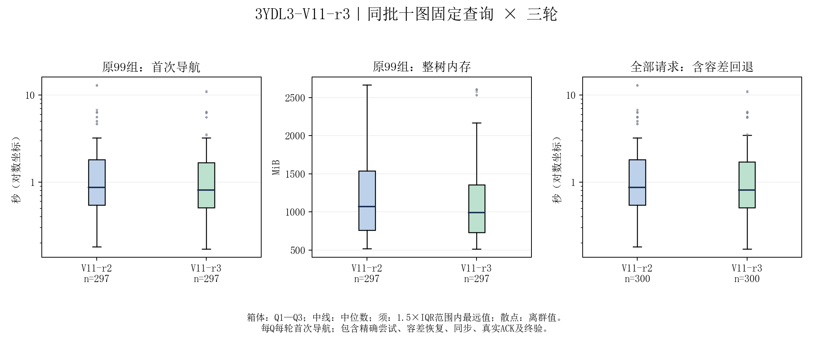
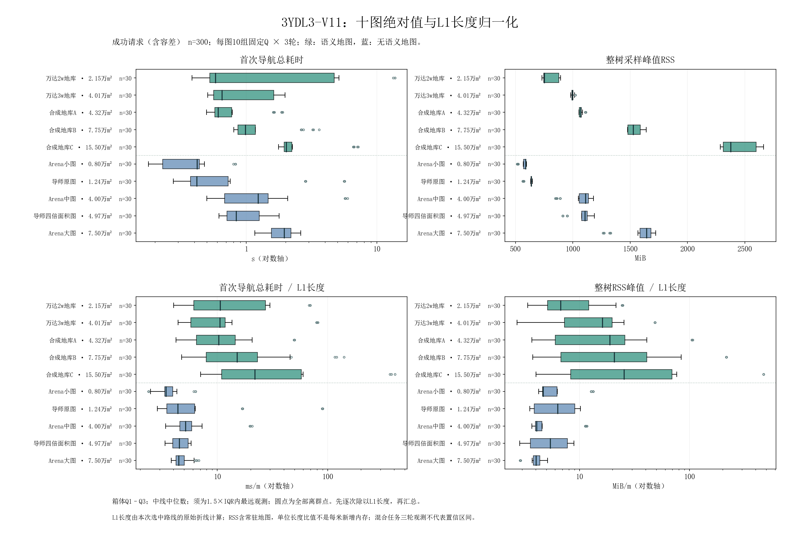

# PUDU Robot Workspace · 3YDL3-V11-r3

当前导航研究交付版本：**3YDL3-V11-r3**，已提交到`main`。十图固定10Q×3轮，政策内成功**300/300**，其中**297次精确成功＋3次授权容差成功**。

[项目源码与运行说明](research/3ydl3_v11_r3/README.md) · [V11-r3完整报告](docs/3ydl3_v11_r3/RESULTS.md) · [验收记录](research/3ydl3_v11_r3/ACCEPTANCE.json) · [600条原始统计CSV](research/3ydl3_v11_r3/report/paired_rows.csv)

本次上传代码、测试、配置、原生库和结果报告，**不包含十张地图文件及其派生地图数据**。运行所需原地图、配套Q和绑定登记需另行提供。历史工作区代码及说明保留在下方。

## V11-r3 首次导航验收结果

同批对照为V11-r2；主指标采用原99组精确成功任务，每版297次。三个至少降低5%的预设观测门槛均通过。

| 指标 | 同批V11-r2 | V11-r3 | 降低 |
|---|---:|---:|---:|
| 首次导航耗时中位 / s | 0.866489 | **0.811148** | **6.39%** |
| 首次导航耗时P95 / s | 4.780567 | **3.276995** | **31.45%** |
| 整套规划进程树RSS中位 / MiB | 1069.570312 | **992.679688** | **7.19%** |

只计地图与服务就绪后的各Q首次实际导航，包含失败尝试、恢复、L1/L2/L3、任务同步、真实ACK、严格终验及返回前堆回收；不含地图加载、初始化、启动和请求后导出。每轮每Q一次，不使用重复任务结果命中。RSS为请求内整树采样峰值。

1442项项目检查、49项受控事件断言、三组查询顺序及两个默认入口验证通过。原297对精确成功的L1/L2/软目标/有效代价图/最终路径均相同。导师原图A2B-07在精确失败后仅终点朝向调整+5°，原0.40m半径与严格证书保持。



箱线图由正式逐次记录生成：箱体Q1–Q3，中线中位数，须为1.5×IQR内最远样本，保留离群点；样本数、单位和对数坐标见图，图中文字使用宋体。总体通过不表示每张地图都改善5%，仅静态规划与指定事件回放验收，非连续控制或实车验收。

## 用户指定网页的十图总览

[在线十图总览](https://gquhtm3ghb2.feishuapp.com/app/app_17e7839sdbs/?view=l3r7&map=mengjia&query=Q09&section=experiment)当前发布的是较早的 **3YDL3-V11 requestctx** 数据，下面忠实保存该网页结果，**不将其标记为V11-r3**。已按发布提交和云端文件SHA-256回读核对。

| 地图 | 类型 | 面积 / 万m² | 精确 / 容差 | 导航中位 / s | RSS中位 / MiB | 导航/L1 / ms/m | RSS/L1 / MiB/m |
|---|---|---:|---:|---:|---:|---:|---:|
| 万达2w地库 | 语义 | 2.15 | 30 / 0 | 0.581 | 752.7 | 10.621 | 6.717 |
| 万达3w地库 | 语义 | 4.01 | 30 / 0 | 0.652 | 995.3 | 10.563 | 16.138 |
| 合成地库A | 语义 | 4.32 | 30 / 0 | 0.607 | 1069.3 | 10.284 | 18.852 |
| 合成地库B | 语义 | 7.75 | 30 / 0 | 0.986 | 1526.2 | 15.048 | 20.730 |
| 合成地库C | 语义 | 15.50 | 30 / 0 | 2.026 | 2375.2 | 21.799 | 25.373 |
| Arena小图 | 无语义 | 0.80 | 30 / 0 | 0.420 | 587.8 | 3.421 | 4.658 |
| 导师原图 | 无语义 | 1.24 | 27 / 3 | 0.418 | 638.0 | 4.386 | 6.307 |
| Arena中图 | 无语义 | 4.00 | 30 / 0 | 1.234 | 1111.7 | 5.151 | 4.076 |
| 导师四倍面积图 | 无语义 | 4.97 | 30 / 0 | 0.836 | 1106.1 | 4.505 | 5.428 |
| Arena大图 | 无语义 | 7.50 | 30 / 0 | 1.945 | 1643.1 | 4.451 | 4.011 |

每图30次首次导航，政策内成功均为30/30。导师原图为27次精确成功、3次容差成功；三轮均仅终点朝向调整+5°，位置不变。其余地图全部精确成功。

时间只计地图和服务就绪后的各Q首次实际导航，包含失败尝试、L1/L2/L3、任务同步、真实ACK与严格终验。RSS为整套规划进程树逐请求采样峰值，包含常驻地图。

长度归一化先逐次计算“指标÷本次L1路线长度”，再取中位数；不使用“两个中位数相除”。RSS/米是尺度比较值，不代表每行驶一米新增内存。地图面积为幅面面积，非可通行面积。不同地图使用各自配套Q，不能把任务难度差异全归因于地图规模。




[网页总览详细口径](docs/3ydl3_v11_r3/WEB_OVERVIEW.md) · [300条网页统计CSV](docs/3ydl3_v11_r3/web_overview/v11-crossmap-requests.csv) · [发布来源与校验](docs/3ydl3_v11_r3/web_overview/PROVENANCE.json)

## 校验本次交付

```bash
python3 tools/verify_3ydl3_v11_r3.py
```

源码按验收版本保留原路径；运行依赖和地图缺省说明见[项目README](research/3ydl3_v11_r3/README.md)。本次是代码与结果发布，没有重跑实验。

<details>
<summary>历史工作区与既有启动说明</summary>


历史代码快照：[`pln-02-snapshot-2026.09.09`](docs/releases/PLN-02_2026-09-09.md)。
3D-V1 默认为 `3D-V1-r2-stable`；2A-V1-r3 与语义 2A-V3 仍是研究版，
具体准入边界、依赖还原方式和未随 Git 分发的数据见版本说明。

独立研究主线 [STL-V0：语义规则、可行空间集合与路线轨迹联合求解](docs/PLN-02_ARCHITECTURE_STL_V0.md) 已建立，当前为离线研究原型。 最新 [r2 实验报告](docs/PLN-02_STL_V0_R2_PERFORMANCE_AND_REFINEMENT.md) 记录构图降耗与曲线细分结果。

中文启动、停止和功能说明见 [USAGE.md](USAGE.md)。
2026-09-14 的 [源码交付清单](docs/PLN-02_PROJECT_SNAPSHOT_20260914.md) 新增 r3 静态服务、STL-V0-r2 与 [3YD-V1 语义双地图静态研究版](research/3yd_v1/README.md)；研究版不替代生产默认，私有地图与实验缓存不随 Git 分发。
Arena4 单次录制、指标计算和绘图见
[docs/ARENA4_EVALUATION_USAGE.md](docs/ARENA4_EVALUATION_USAGE.md)。
超大地图 A2B 课题的 P0 冻结口径见
[docs/P0_EVALUATION_DEFINITION.md](docs/P0_EVALUATION_DEFINITION.md)。

Product workspace for PUDU-specific robot description, Nav2 integration,
plugins, coverage planning, cleaning behavior trees and navigation tests.
Related third-party workspaces are grouped under `external/` while remaining
separate colcon overlays.

## Workspace boundaries

- `external/nav2_reference_ws`: upstream Nav2 and TurtleBot3 simulation.
- `external/linorobot_sim_ws`: Linorobot2 Gazebo/SLAM/Nav2 integration.
- `external/exploration_reference_ws`: pinned ROS 2 frontier exploration.
- `external/scurm_sentry_ws`: pinned optional SCURM/FAST-LIO/ICP underlay.
- `external/arena4_ws`: optional Arena simulation/evaluation environment;
  independently built and runtime-isolated from the PUDU overlay.
- `src`: PUDU-owned packages.

`stack_paths.bash` is the single path registry. Legacy `/home/robot/*_ws`
locations remain compatibility symlinks, so existing commands and old colcon
artifacts continue to work. `external/COLCON_IGNORE` keeps the PUDU top-level
build from discovering external packages twice.

## Build

```bash
cd /home/robot/pudu_robot_ws
./build_all.bash
```

For a relocation or a full CMake reconfigure, run
`PUDU_CLEAN_CMAKE_CACHE=true ./build_all.bash`. For PUDU-only incremental
changes, `source setup_underlays.bash && colcon build --symlink-install`
remains available.

## Linorobot2 simulation shortcuts

If Gazebo is not installed system-wide, install the required simulator and ROS
plugins into the existing local dependency root (no sudo required):

```bash
./install_gazebo_local.sh
```

Start Gazebo, Nav2 with the existing `playground` map, and the navigation RViz
view in the background:

```bash
./start_linorobot.sh
```

Start Gazebo, online SLAM, and the mapping RViz view instead:

```bash
./start_linorobot.sh --slam
```

Start Gazebo, SLAM/Nav2/RViz, and autonomous frontier exploration:

```bash
./start_linorobot.sh --explore
```

The simulation uses ROS domain `42` by default to avoid interference from
unrelated ROS nodes. In every additional terminal, load the matching runtime
environment before using `ros2` commands:

```bash
source /home/robot/pudu_robot_ws/setup_linorobot_runtime.bash
```

Stop all processes started by that command:

```bash
./stop_linorobot.sh
```

The default base is `2wd`. Override it or pass Gazebo launch arguments when
needed, for example:

```bash
LINOROBOT2_BASE=4wd ./start_linorobot.sh spawn_x:=1.0 spawn_y:=2.0
```

## Optional SCURM integration

Build or reproduce the pinned upstream workspace:

```bash
./build_scurm_reference.sh
```

Run the SCURM-inspired PUDU navigation profile in the existing simulation:

```bash
./start_linorobot.sh --scurm-nav
```

Run the full 3D SCURM localization path in Gazebo (ICP + FAST-LIO, no AMCL):

```bash
./start_linorobot.sh --scurm-lio
```

Run the same SCURM pipeline with an isolated 1.5x Gazebo time profile:

```bash
./start_linorobot.sh --scurm-lio --fast-sim
```

The normal command remains at the source world's default speed and 360x16
lidar sampling. The fast profile changes only the running Gazebo process to a
2 ms physics step, a 750 Hz update target, and a 120x16 lidar profile; ROS
nodes continue to use simulation time.

Optionally add known-map full-area coverage without changing the normal SCURM
startup path:

```bash
./start_linorobot.sh --scurm-lio --coverage
# Or combine both independent options:
./start_linorobot.sh --scurm-lio --coverage --fast-sim
```

The coverage option now builds a plan from the robot-reachable known-free
component of `/map` automatically. After inspecting the full-map route, run:

```bash
source ./setup_linorobot_runtime.bash
ros2 service call /coverage/start std_srvs/srv/Trigger '{}'
```

Using RViz **Publish Point** plus `/coverage/close_area` remains available when
only a manually selected sub-area should be covered.

The optional planner decomposes free space around obstacles, follows continuous
boustrophedon lanes through Nav2, records actual covered cells from TF, and
replans residual missed regions. See
[`src/pudu_coverage_planner/README.md`](src/pudu_coverage_planner/README.md) for
controls, topics, and tuning.

Run FAST-LIO 3D mapping and save the PCD through `/map_save`:

```bash
./start_linorobot.sh --scurm-lio-map \
  map_output_path:=/tmp/scurm_playground_map.pcd
```

This selects Theta*, Constrained Smoother, differential-drive MPPI, and the
PUDU adaptive backup behavior. The normal `./start_linorobot.sh` path is
unchanged. Check or start the optional FAST-LIO/Livox hardware pipeline with:

```bash
./start_scurm.sh --check
./start_scurm.sh --mapping
./start_scurm.sh --localization map_path:=/absolute/path/map.pcd
```

See [SCURM_INTEGRATION.md](SCURM_INTEGRATION.md) for boundaries, verified
features, and hardware prerequisites.

## Optional Arena4 environment

Arena4 remains an independent ROS overlay because it carries 498 source
packages, its own Python environment, Gazebo Harmonic, Fast DDS, and ROS domain
`1`. It is nevertheless managed from this project root:

```bash
./start_arena4.sh --check
./start_arena4.sh                 # standard GUI
./start_arena4.sh --scenario      # reproducible task setup
./start_arena4.sh --headless --scenario
./stop_arena4.sh
```

Use `./build_arena4.bash` for an isolated Arena rebuild and source
`setup_arena4_runtime.bash` in an additional terminal for Arena ROS commands.
The existing PUDU build and Linorobot/SCURM startup paths are unchanged.


</details>
