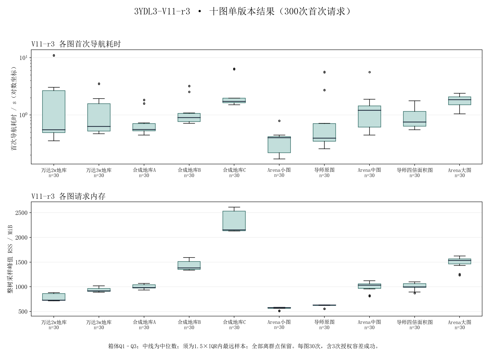

# 3YDL3-V11-r3 单版本结果

| 指标 | V11-r3，全部300次请求 |
|---|---:|
| 政策内成功 | 300/300（297次精确＋3次容差） |
| 首次导航耗时中位 / s | 0.815621 |
| 首次导航耗时P95 / s | 3.656539 |
| 整套规划进程树RSS中位 / MiB | 990.388672 |

每图使用各自配套固定Q01–Q10或A2B-01–A2B-10，每轮每Q首次实际请求一次，共三轮。统计包含全部300次请求及其中3次容差回退；不是服务启动后的首个Q子集，也不使用重复任务缓存命中。

时间从地图与服务就绪后的导航请求开始，至完整规划、真实ACK及严格终验完成返回；包含失败尝试、恢复、L1/L2/L3、任务地图同步和返回前堆回收，排除地图加载、通用初始化、服务启动及请求后导出。RSS为每次请求内整套规划进程树的采样峰值。P95使用线性分位数。

## 十图结果

| 地图 | 成功次数 | 精确 / 容差 | 导航中位 / s | 导航P95 / s | 整树RSS中位 / MiB |
|---|---:|---:|---:|---:|---:|
| 万达2w地库 | 30/30 | 30 / 0 | 0.549 | 10.927 | 729.4 |
| 万达3w地库 | 30/30 | 30 / 0 | 0.625 | 3.490 | 918.8 |
| 合成地库A | 30/30 | 30 / 0 | 0.555 | 1.817 | 986.6 |
| 合成地库B | 30/30 | 30 / 0 | 0.894 | 3.193 | 1381.7 |
| 合成地库C | 30/30 | 30 / 0 | 1.720 | 6.378 | 2151.8 |
| Arena小图 | 30/30 | 30 / 0 | 0.399 | 0.786 | 577.6 |
| 导师原图 | 30/30 | 27 / 3 | 0.392 | 5.555 | 629.5 |
| Arena中图 | 30/30 | 30 / 0 | 1.206 | 5.588 | 1032.1 |
| 导师四倍面积图 | 30/30 | 30 / 0 | 0.750 | 1.668 | 995.8 |
| Arena大图 | 30/30 | 30 / 0 | 1.848 | 2.348 | 1534.8 |

箱体Q1–Q3，中线为中位数，须为1.5×IQR内最远样本，保留全部离群点。每图n=30，时间轴为对数坐标，内存轴为线性坐标，图中文字为宋体。

## 校验与运行范围

原验收记录中，项目检查1442项、受控事件断言49项、查询顺序3组、默认入口2项通过。本次仅整理发布内容，没有重跑导航实验。

先精确规划，失败后才允许起点、终点分别使用不超过0.20m、±30°的授权容差，最小转弯半径保持0.40m。导师原图A2B-07三轮仅终点朝向调整+5°，双端位置和起点朝向不变；因此不能写成精确端点300/300。

验收范围为十图静态完整规划及指定受控事件回放。万达3w Q09前方障碍仍会预期撤回轨迹并在清除后恢复；不代表所有动态绕障、连续控制或实车验收。容差起点也不代表已认证从实时定位到该点的执行连接。

## 原始统计

[300条逐次记录](../../research/3ydl3_v11_r3/report/requests.csv) · [单版本汇总](../../research/3ydl3_v11_r3/report/SUMMARY.json) · [数据来源校验](../../research/3ydl3_v11_r3/report/PROVENANCE.json)
