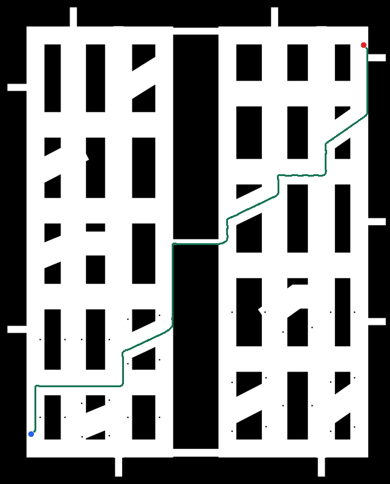

# 可公开复现：3YDL3-V11-r4 × 合成地库 B

这是完整三层静态规划的最小运行入口。包内提供原固定地图/语义/拓扑/停车接入和 Q01–Q10，地图为 250 × 310 m、0.05 m/格（5000 × 6200）。默认仅运行 Q01；算法、约束和严格审计沿用已验收 r4。



绿色为本示例实际输出，蓝点为起点，红点为终点。背景为公开合成地图；图片不添加文字标签。

## 环境与安装

支持 Ubuntu 22.04 amd64、Python 3.10、ROS 2 Humble。建议 4 GiB 以上可用内存、2 GiB 以上临时磁盘。`bubblewrap` 需要 Linux 用户命名空间；容器运行时需允许创建命名空间（CI 使用特权容器）。

先使用[ROS 官方 Ubuntu 安装说明](https://docs.ros.org/en/humble/Installation/Ubuntu-Install-Debs.html)配置 Humble 的 apt 源。在仓库根目录执行：

```bash
sudo bash examples/3ydl3_garage_b/install_system_dependencies.sh
python3 -m venv .demo-venv
.demo-venv/bin/pip install --require-hashes -r examples/3ydl3_garage_b/requirements.lock
```

Python 直接与间接依赖全部锁定版本和 wheel SHA-256。核心版本为 NumPy 1.24.4、SciPy 1.8.0、Clarabel 0.11.1、OSQP 0.6.7.post3、OpenCV 4.5.4。安装脚本锁定 Nav2 1.1.20 的 apt 构建版本；包内同时提供验收时相互匹配的 Nav2 1.1.19 规划服务/插件库、修改版 costmap 库及对应源码；运行时优先使用这一整组接口，避免与系统 1.1.20 库混用。CI 基础镜像也固定 SHA-256，实际系统包版本随 CI 证据导出。Ubuntu 的传递系统依赖仍由 apt 解析；本发布不声称提供整个操作系统的逐字节快照。

若锁定的 apt 构建已被镜像移除，安装会明确失败；不要静默改为任意最新版。应在新发布中调整依赖并重跑完整示例。

## 运行命令

每次指定一个**不存在的新输出目录**，程序保留失败日志：

```bash
# 完整性校验，只需 Python 标准库
python3 examples/3ydl3_garage_b/demo.py --verify-only

# 检查隔离环境、依赖和输入绑定，不启动导航
.demo-venv/bin/python examples/3ydl3_garage_b/demo.py \
  --probe --venv .demo-venv --output /tmp/garage-b-probe

# 最小示例：原固定 Q01
.demo-venv/bin/python examples/3ydl3_garage_b/demo.py \
  --venv .demo-venv --output /tmp/garage-b-q01

# 完整十组，每个 Q 首次请求一次
.demo-venv/bin/python examples/3ydl3_garage_b/demo.py \
  --all-queries --venv .demo-venv --output /tmp/garage-b-fixed10
```

无需创建 `/home/robot` 或拷贝原研究工作区。运行器将包内组件只读映射到私有命名空间；宿主主目录、其他研究目录和共享内存不用于规划。CPU 默认取当前允许集合的第一核，可用 `--cpu <核编号>` 指定；一次运行串行执行。地图栅格只做无损解压，原始字节 SHA-256 和完整地图/Q/停车接入绑定都必须通过验证。

## 预期结果

默认 Q01 输出 `passed: 1, total: 1`；完整十组输出 `passed: 10, total: 10`。每组均精确成功、无端点容差。下表是原 r4 的参考值，跨机器允许长度 1% 数值差异，但仍必须通过全部原严格校验和当前输出一致性检查。

| Q | 参考长度 / m | 原连续曲率上界 / m⁻¹ |
|---|---:|---:|
| Q01 | 422.901775 | 1.561020 |
| Q02 | 239.804142 | 1.701859 |
| Q03 | 83.669544 | 1.752530 |
| Q04 | 36.739440 | 1.541298 |
| Q05 | 71.207563 | 1.498783 |
| Q06 | 75.423570 | 1.731656 |
| Q07 | 20.209439 | 1.224166 |
| Q08 | 50.524312 | 1.503162 |
| Q09 | 11.864521 | 1.279649 |
| Q10 | 371.075823 | 2.478395 |

验证器先核对实际加载的 Smac、costmap 核心和膨胀层库 SHA-256，再检查精确端点、车体/运动学/交通审计、真实 ACK 零不匹配、独立 L3 和曲率证书，并将导出 `path.npy` 的位置/切向与实际三次样条绑定。曲率上界必须 ≤2.5 m⁻¹。结果在 `validation.json`，原始运行结果在 `run/`；每组分层输出在 `run/cases/Qxx_1/`。

原生库检查覆盖快照中每个进程、每条路径下的同名库：任何副本的哈希不匹配都会拒绝结果，不会被后出现的正确副本覆盖。相同哈希的重复加载允许通过，三种必需库仍须全部出现。

查看自己这次运行的结果图：

```bash
.demo-venv/bin/python examples/3ydl3_garage_b/render_result.py \
  /tmp/garage-b-q01/run/cases/Q01_1 /tmp/garage-b-q01/path.png
```

耗时和内存不作为跨机器固定断言。运行中的导航耗时包括 L1/L2/L3、任务同步、全部恢复、真实 ACK 和严格终验，排除请求前地图/通用初始化及请求后导出。本示例证明静态参考规划可复现，不证明动态控制、实车执行或全局最优。

## 原生代码与许可

`runtime/` 提供运行源码、原生 C++ 源码及 Linux x86_64 二进制。可在已配置 Humble 开发依赖的检出副本中重编译：

```bash
source /opt/ros/humble/setup.bash
# 开发重编译还需要 g++、cmake、colcon 与相应 ROS 开发包
python3 examples/3ydl3_garage_b/maintenance/build_native.py --jobs 1
python3 examples/3ydl3_garage_b/maintenance/refresh_manifest.py
```

重编译会修改当前副本的原生二进制；应检查差异，并重新执行完整十组与测试。`SOURCE_PROVENANCE.json` 保留原验收文件的哈希；`MANIFEST.json` 校验本次分发字节。许可范围见 [LICENSING.md](LICENSING.md)。

## 常见问题

- `bwrap: ... Operation not permitted`：系统禁用了用户命名空间或容器限制了 `unshare`。使用允许命名空间的 Linux 环境；CI 配置提供了可参照的容器选项。
- `DEMO_FILE_CHANGED` / `FROZEN_INPUT_CHANGED`：下载文件或固定输入发生变化，请重新取得原发布。不要通过刷新清单绕过用户侧错误。
- `Run failed`：检查输出目录的 `console.log` 和 `run/smac/logs/`。已存在的输出目录会被拒绝，防止覆盖证据。
- 架构或 Python 版本不符：本版只提供 amd64 / Python 3.10 的固定 wheel 和原生库，ARM/Windows/macOS 不在此发布验收范围。
